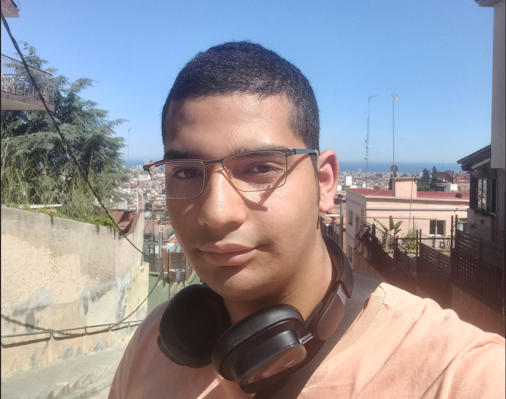

# Autor
## ¿Quién es el encargado?
Hola, soy Diego Didier Aguayo Cevallos pero, solo diganme Diego. Yo soy el único miembro del grupo y debo de decir que estoy bastante emocionado ver como termina el resultado final del proyecto intermodular.

## Objetivo
Obiamente busco aprender pero en general y haciendo un conteo completo busco estas cosas:
- Aprender lo más posible de este proyecto.
- Tratar de impresionar lo más psible a los demas (principalmente al profesor Pablo) o por lo menos hacerlos sacar alguna sonrisa.
- Divertirme y explotar lo más posible mi creatividad.
- Este no creo que suceda pero si es posible pues quiero convertir este proyecto en una realidad por la original y útil y me encantaría que existiera ya que es algo que yo muchas veces hubiera necesitado.