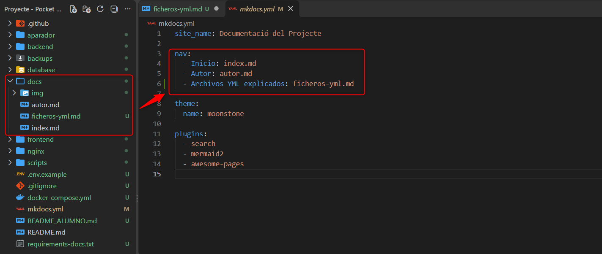
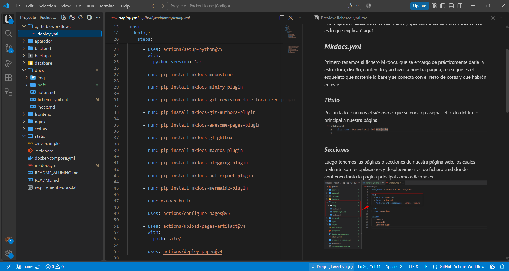
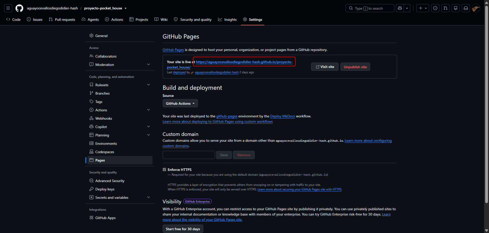

# *Ficheros .yml explicados*

Para darle forma a nuestra página web en GitHub entran en juego dos ficheros clave para este objetivo, el fichero `mkdocs.yml` y el `deploy.yml`, ambos perteneciendos a un tipo de fichero conocido como YAML (YAML Ain't Markup Language), siendo un formato de serialización de datos basado en texto plano por tabulación. 

¿Pero qué son estos ficheros realmente y que funciones cumplen? Bueno eso es lo que explicaré aquí.

## *Mkdocs.yml*

Primero tenemos al fichero Mkdocs, que se encarga de prácticamente darle la estructura, diseño, contenido y archivos a nuestra página, o sea que es el esqueleto que sostenie la base y se conecta con el resto de cosas y que habrán en este.

### *Título*

Por un lado  tenemos el *site name*, que se encarga asignar el texto del título principal a nuestra página.

### *Secciones*

Luego tenemos las páginas o secciones de nuestra página web, los cuales realemte son recopilaciones y desplegamientos de ficheros.md donde contienen tanto la página principal como adicionales.

### *Tema*

La forma en la que se ve la página se le dice tema, donde este es seleccionado por medio de su nombre/tipo.

### *Plugins*

Para finalizar, tenemos las plugins, que son complementos de fragmentos de software independientes que agregan funciones adicionales a nuestra página, es decir extensiones.

La variedad de estos es grande, pero por ejemplo tenemos el plugin de Search, que permite tener una opción para buscar documentos, títulos, secciones, etc:

## *Deploy.yml*

Por otro lado, tenemos el fichero Deploy, que como dice el mismo nombre, despliega una automatización de la construcción y publicación de nuestra página como GitHub Pages por medios de comandos preinstalados. Es decir, es el encargado de mostrar el contenido de la página en GitHub.

